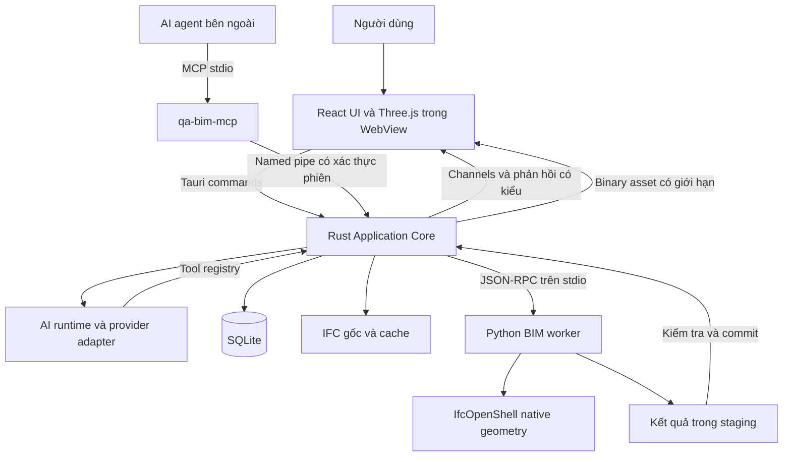

# Kiến trúc QA BIM Desktop

QA BIM là ứng dụng desktop chia module, dùng một Rust application core và worker BIM độc lập. Thiết kế dưới đây là phương án triển khai đã chọn; hiệu năng và chi tiết exporter cần được xác nhận tại G1.

## Phạm vi sản phẩm

Bản pilot phục vụ BIM Coordinator kiểm tra phối hợp STR, ARC và MEP trên Windows x64. Chuỗi công việc là nhập IFC, xem mô hình, xác định phạm vi, chạy kiểm tra, duyệt kết quả, tạo issue và kiểm tra lại sau cập nhật.

MVP hỗ trợ IFC2x3 và IFC4 trong phạm vi bộ mẫu đã kiểm thử; IFC4.3 là hạng mục khảo sát sau. BCF XML 2.1 là đích trao đổi đầu tiên. Không tuyên bố hỗ trợ mọi kiểu hình học chỉ từ tên schema.

## Các tiến trình

### Desktop shell

Tauri quản lý cửa sổ, file dialog, khởi động, single instance, deep link nội bộ, tài nguyên và cập nhật. Shell chỉ là adapter; application core có thể được kiểm thử không cần WebView.

Tauri capabilities giới hạn các lệnh mà từng cửa sổ được gọi. Lớp policy nghiệp vụ trong Rust tiếp tục kiểm tra quyền của UI, MCP và AI; không mặc định cho rằng capabilities của WebView bảo vệ được named pipe.

### React và renderer

React quản lý layout, panel, form, bảng phân trang và thông báo. Zustand chỉ giữ trạng thái giao diện; dữ liệu lưu bền được lấy từ core. Không đưa toàn bộ thuộc tính hoặc mesh của mô hình vào React state.

Chọn Three.js với GLTFLoader làm renderer cơ sở. Scene graph, geometry, GPU resource và camera nằm ngoài vòng render React. Viewer Adapter cung cấp load/unload, selection, visibility, color, section, camera, screenshot và applied-state acknowledgement.

That Open/Fragments chỉ được khảo sát như một renderer/cache adapter nếu cần cải thiện hiệu năng. Không mặc định thêm một pipeline parse IFC thứ hai. Việc adapter mới nhận được geometry/mapping từ IfcOpenShell phải được chứng minh trước khi chọn.

### Rust application core

Core sở hữu ProjectSession, ModelRegistry, QueryService, CommandRegistry, JobManager, IssueService, ViewCoordinator, PolicyService và AuditService.

Nghiệp vụ được triển khai theo use case có kiểu như ImportModel, RunCheck và OpenFinding. Domain không phụ thuộc Tauri, HTTP hoặc nhà cung cấp AI. Tokio dùng cho I/O và điều phối; công việc CPU nặng chạy worker hoặc bounded blocking pool, không chặn async executor.

### BIM worker

Python worker đọc IFC, trích thuộc tính và hình học, xuất render cache, chạy check và xử lý BCF qua adapter. IfcOpenShell thực hiện phần hình học native. Worker không tự ghi project.db.

Rust là bên duy nhất ghi dữ liệu dự án. Worker xuất artifact vào staging riêng cho từng job; core kiểm tra schema, hash, coverage và phiên bản đầu vào trước khi nhập vào DB. Kết quả sai snapshot không được gắn nhãn kết quả hiện hành.

Giới hạn ban đầu là một geometry job nặng trong một project session. Worker có model handle và LRU với ngân sách RAM; không giữ vô hạn nhiều IFC và geometry tree. Tăng song song chỉ sau benchmark vì nhiều thread/process có thể nhân RAM.

### MCP bridge

Binary qa-bim-mcp phục vụ MCP stdio và chuyển lời gọi tới đúng desktop session qua named pipe Windows. Bridge không sở hữu DB hay chạy một bản application core thứ hai.

Desktop có thể mở nhiều project theo thời gian; mỗi lời gọi có projectId và sessionId rõ ràng. Nếu không có phiên tương ứng, trả APP_NOT_RUNNING hoặc PROJECT_NOT_OPEN. Việc tự mở app/project là một công cụ riêng, không là tác dụng phụ ngầm của truy vấn.

## Trách nhiệm các module

| Module | Sở hữu | Mở rộng sau |
| --- | --- | --- |
| Projects | Manifest, file references, session, backup | Gói dự án di động |
| Models | ModelVersion, element index, transform, import report | So sánh phiên bản |
| Query | Filter AST, SelectionSet, typed properties | Bảng dữ liệu và thống kê |
| Viewer | ViewState, selection, section, review overlay | Bản đồ tầng, point cloud |
| Checks | RuleDefinition, RuleRevision, CheckRun, Finding | Clearance, IDS, data QC |
| Issues | Issue, comments, viewpoints, BCF mapping | Team workflow và sync |
| Automation | Job, schedules thủ công, quy trình có phiên bản | Batch và headless runner |
| AI | Provider interface, tool loop, context, usage | Local model và tài liệu dự án |
| MCP | Tool/resource adapter, session routing | Remote transport khi cần |

## Pipeline nhập và hiển thị IFC

1. Người dùng chọn file. Core kiểm tra file và tạo ModelVersion ở trạng thái importing.
2. Tạo bản snapshot IFC bất biến trong model store; hash bản snapshot, không hash file rồi đọc lại một file có thể đã bị thay đổi.
3. Worker đọc schema/header, đơn vị, spatial tree, placements và quan hệ. Ghi lỗi theo đối tượng và tổng coverage.
4. Chuẩn hóa metadata vào dữ liệu staging; mỗi cấu kiện có internal element ID ổn định trong phiên bản đó.
5. Sinh geometry bằng iterator; xuất GLB theo chunk, manifest và ánh xạ render object về element ID. Cache không thay IFC làm dữ liệu gốc.
6. Core kiểm tra mapping, transform, hash và manifest. Chỉ commit version ready sau khi metadata/cache hợp lệ; nếu thiếu hình học, ghi ready_with_warnings và danh sách phần bị thiếu.
7. Viewer tải chunk ưu tiên theo tầng/vùng nhìn trong giới hạn RAM/GPU. Thuộc tính được tải theo yêu cầu qua QueryService.
8. Khi thay mô hình, tạo version mới. Version cũ và issue liên quan vẫn truy xuất được.

IfcOpenShell có geometry iterator và serializer glTF/GLB. Khả năng giữ identity, materials, openings và chunking với phiên bản thực dùng phải được kiểm thử. Nếu serializer không giữ đủ mapping, bổ sung exporter adapter sử dụng iterator; không suy luận identity chỉ từ tên node.

## Hình học và tọa độ

Lưu chuỗi chuyển đổi rõ ràng: representation/placement IFC → model coordinates → project coordinates → render-local coordinates. Render dùng gốc gần công trình; metadata và phép tính giữ double precision.

Đơn vị nội bộ cho chiều dài là mét. Dung sai nhập mm được đổi một lần ở boundary. Renderer có thể đổi Z-up của BIM sang trục của scene qua một matrix có phiên bản. Matrix đảo được dùng cho picking, clash markers, đo và BCF.

Map conversion/georeferencing phải được giữ riêng với local engineering placement. Không áp dụng map conversion hai lần. Transform người dùng sửa là một revision, làm cũ check runs liên quan; tuyệt đối không sửa IFC gốc để căn mô hình trên màn hình.

## Pipeline kiểm tra

QueryService resolve nhóm A/B theo snapshot; worker nhận model versions, rule revision, transform revisions và đơn vị/dung sai. Với check chéo file, geometry phải nằm trong cùng project frame trước khi so sánh. G1 phải chứng minh cách dùng engine để áp transform federation, không giả định per-file tree tự hiểu offset của app.

Pipeline gồm lọc cặp ứng viên bằng spatial bounds, kiểm tra hình học chính xác theo semantics của rule, loại trùng có kiểm soát, lưu findings và coverage. Bounding box overlap chỉ là ứng viên; không được báo thành hard clash.

Không dùng một tolerance cho mọi ý nghĩa. Rule tách numerical epsilon, penetration threshold và required clearance. Kết quả nào engine không cung cấp penetration depth đáng tin cậy thì để null và ghi measurement kind, không chế tạo số đo.

Findings là bằng chứng của một lần chạy. Conflict là thực thể đối chiếu qua các lần chạy. Issue là hồ sơ con người xử lý, có thể chứa nhiều conflict. Gom nhóm theo tầng/hệ thống chỉ là projection của dữ liệu.

## Lưu trữ và phục hồi

Mỗi project là một thư mục có manifest, project.db, IFC snapshots và artifacts. Cache có thể nằm trong project hoặc user cache theo cấu hình; manifest dùng logical path, không bắt buộc đường dẫn máy cũ.

SQLite dùng migrations và foreign keys. Một core writer quản lý transaction; worker không mở DB để ghi. WAL dùng trên ổ local. Không hỗ trợ nhiều máy cùng mở SQLite qua network share trong MVP.

Khi job hoàn tất: kiểm artifact, publish bằng atomic rename trong cùng volume rồi commit DB tham chiếu. Sự cố giữa hai bước được xử lý bằng startup reconciliation; artifact mồ côi có thể thu gom sau, không xóa file đang được version/issue tham chiếu. Backup dùng SQLite backup API hoặc checkpoint/đóng DB phù hợp, không copy riêng file .db đang dùng WAL.

Khởi động lại chuyển jobs đang running thành interrupted; người dùng có thể chạy lại. Resume giữa chừng chỉ có khi từng loại job có checkpoint được kiểm chứng.

## Giao diện làm việc

Navigation trái: Models, Checks, Issues, Data và Automation. Canvas giữa dành cho 3D/bảng. Panel phải đổi theo ngữ cảnh Properties, Issue hoặc AI. Command palette mở bằng Ctrl+K.

OpenFinding là một thao tác nghiệp vụ: resolve cấu kiện, lưu view trước, cô lập A/B, làm mờ context, đặt section/camera và chờ viewer báo đã áp dụng. Kết thúc review khôi phục view trước. Agent và người dùng dùng cùng hành vi này.

Đầu tiên làm theme sáng, typography rõ, icon ít, toolbar ngắn, panel thu gọn và bảng virtualized. Chế độ tối là tính năng sau khi luồng chính ổn định.

## Công nghệ hỗ trợ được đề xuất

| Lớp | Lựa chọn |
| --- | --- |
| Rust | Tauri 2, Tokio, serde, thiserror, tracing, SQLx với SQLite, UUID, SHA-256 |
| React | TypeScript strict, Vite, Tailwind, Radix UI, Zustand, TanStack Query/Table, virtualization |
| Viewer | Three.js và GLTFLoader, adapter riêng cho scene và selection |
| Worker | Python, IfcOpenShell, Pydantic; uv để quản lý môi trường phát triển |
| MCP | rmcp official Rust SDK, stdio bridge |
| Kiểm thử | cargo test, Vitest, pytest; smoke test trên Tauri/WebView2 thật |
| Đóng gói | Tauri NSIS, worker frozen bằng PyInstaller sau G1, WebView2 prerequisite |

Đây là danh sách chọn công nghệ, chưa phải lockfile. G0/G1 khóa phiên bản tương thích, không dùng latest trôi nổi trong CI/release. Một số ứng viên có thể đổi nếu benchmark hoặc compatibility test không đạt.

## Đóng gói và vận hành

Một installer chứa app, MCP bridge và worker tương thích. Người dùng không phải cài Python hay Node.js. Dùng worker kiểu one-folder trước để dễ kiểm soát DLL/resources; quyết định cuối sau clean-machine test.

Handshake giữa core/worker kiểm protocolVersion, engineVersion và supportedCapabilities. Cập nhật atomically theo bộ tương thích, không tự cập nhật riêng IfcOpenShell trên máy người dùng.

Logs dùng correlationId/jobId, xoay vòng và che secrets. Gói chẩn đoán liệt kê OS, WebView2, GPU/driver, versions, counts và lỗi; IFC/properties không tự đưa vào log hay upload.

## Nguồn kỹ thuật

- [Tauri capabilities](https://v2.tauri.app/security/capabilities/).
- [Tauri commands và channels](https://v2.tauri.app/develop/calling-rust/).
- [Tauri sidecar](https://v2.tauri.app/develop/sidecar/).
- [IfcOpenShell geometry processing](https://docs.ifcopenshell.org/ifcopenshell-python/geometry_processing.html).
- [IfcOpenShell geometry tree](https://docs.ifcopenshell.org/ifcopenshell-python/geometry_tree.html).
- [IfcConvert](https://docs.ifcopenshell.org/ifcconvert.html).
- [Three.js GLTFLoader](https://threejs.org/docs/pages/GLTFLoader.html).
- [MCP Rust SDK](https://github.com/modelcontextprotocol/rust-sdk).
